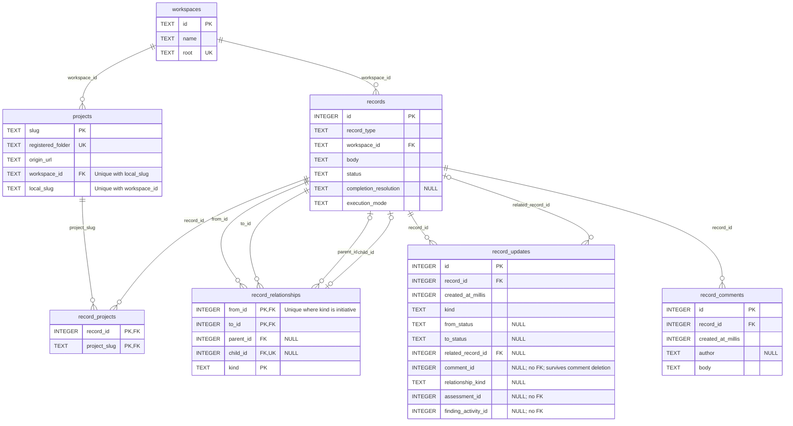
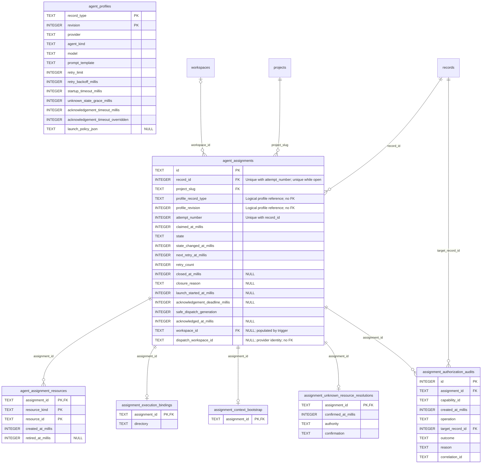
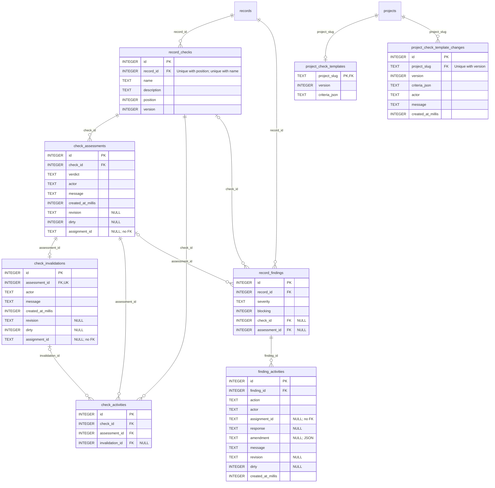

# Store database structure

`forge-store` implements the application's persistence boundary using SQLite.
This is a reference for the schema after initialization, including columns added
by migrations—not just the initial `CREATE TABLE` statements.

## Source of truth

- [`src/lib.rs`](src/lib.rs): `SqliteProjectRepository::from_connection`,
  `migrate_*` functions, profile seeds, and repository operations.
- [`src/workspaces.rs`](src/workspaces.rs): Workspace ownership and Project identity.
- [`src/record_workspaces.rs`](src/record_workspaces.rs): Record ownership,
  cross-Workspace guards, and update-history migration.
- [`src/checks.rs`](src/checks.rs): Task Checks, Assessments, Invalidations,
  activity history, and completion gating.
- [`src/findings.rs`](src/findings.rs): Task Findings and retained review cycles.
- [`src/execution_modes.rs`](src/execution_modes.rs): explicit policy handoff,
  atomic ownership/resource gates, mode-change history and start authorization.
- [`src/check_templates.rs`](src/check_templates.rs): Project Check Templates,
  replacement history, and Task provisioning.
- [`src/workspace_dispatch.rs`](src/workspace_dispatch.rs): Workspace dispatch
  configuration, provider generations, and Assignment binding.

Keep this reference in sync when those schema definitions change. Domain behavior
is documented separately in [Records](../../docs/records.md),
[Workspaces](../../docs/workspaces.md), and [Dispatcher](../../docs/dispatch.md).

## Storage conventions

- Foreign-key enforcement is enabled on repository connections.
- `TEXT` stores identifiers, paths, bodies, enum values, and serialized JSON;
  `INTEGER` stores numeric IDs, counters, timestamps, and boolean flags.
- `*_at_millis`, `*_until_millis`, and deadline timestamps are Unix epoch
  milliseconds; timeout/backoff/grace fields are durations in milliseconds.
- Below, `?` means nullable; otherwise columns are `NOT NULL`, except the SQLite
  integer primary keys named `singleton` (which have no explicit `NOT NULL`).
  `PK`, `FK`, and `UNIQUE` describe database constraints.
- Integer `id` primary keys use SQLite rowid allocation; there is no
  `AUTOINCREMENT` declaration. Record IDs are global within the database, not
  numbered separately per Workspace.
- Foreign keys use SQLite's default delete behavior unless stated otherwise.
  Most references do **not** cascade.
- Only the current marked schema revision is supported. Triggers and repository
  validation also enforce invariants; incompatible stores require a fresh store.

## Entity Relationship Diagrams

These four views describe the core tables. The snapshot and Manual outcome
additions are documented in the appendices below. Boxes without attributes are
references to a table defined in another view, not incomplete definitions.

- Attribute comments beginning with `NULL` mark nullable columns. All other
  attributes are nonnullable in a fresh store (including SQLite integer primary
  keys). Incompatible older schemas are rejected; see below.
- `PK` marks primary-key membership; multiple `PK` attributes form one composite
  key. `FK` marks foreign-key membership. `UK` marks a single-column unique key;
  composite and partial unique indexes are annotated separately.
- Each edge represents a declared foreign key, not an application-level
  association. Crow's-foot notation: `||` = exactly one, `o|` = zero or one,
  `o{` = zero or many. Nullable foreign keys make the referenced entity optional.
- Defaults, enum/check constraints, triggers, and migration details remain in the
  table reference below to keep the diagrams readable.

### 1. Workspaces, Projects, and Records



### 2. Agent profiles, Assignments, and audits

`workspaces`, `projects`, and `records` are reference-only boxes defined in view 1.
Assignment profile columns are logical references: no FK connects Assignments to
`agent_profiles`.



### 3. Dispatch configuration and worktrees

`workspaces`, `projects`, and `records` refer to view 1; `agent_profiles` refers
to view 2. Profile-selection edges each represent a **composite** FK.
`agent_dispatch_configuration` and `dispatch_provider_generation` are standalone
singletons coordinated by triggers, not a foreign key. Generation verification
and provider identities also have no FK edges.

```mermaid
erDiagram
    project_managed_worktree_configuration {
        TEXT project_slug PK,FK
        TEXT setup_hook
    }
    worktree_claims {
        INTEGER record_id PK,FK
        TEXT project_slug FK
        TEXT path UK
        TEXT state
    }
    project_agent_dispatch_configuration {
        TEXT project_slug PK,FK
        INTEGER task_concurrency_limit
    }
    dispatch_holds {
        INTEGER record_id PK,FK
        TEXT reason
    }
    task_base_commits {
        INTEGER record_id PK,FK
        TEXT base_commit
    }
    agent_dispatch_configuration {
        INTEGER singleton PK
        TEXT herdr_socket_path "NULL"
        TEXT dispatch_workspace_id "NULL; legacy; no FK"
        TEXT dispatch_workspace_root "NULL; legacy"
        TEXT scan_lease_owner "NULL"
        INTEGER scan_lease_until_millis "NULL"
    }
    workspace_dispatch_configuration {
        TEXT workspace_id PK,FK
        TEXT task_profile_type FK "Composite FK with task_profile_revision"
        INTEGER task_profile_revision FK "NULL"
        TEXT grilling_profile_type FK "Composite FK with grilling_profile_revision"
        INTEGER grilling_profile_revision FK "NULL"
        TEXT herdr_workspace_id UK "NULL; provider identity"
        INTEGER verified_generation "NULL; logical generation reference; no FK"
    }
    dispatch_provider_generation {
        INTEGER singleton PK
        INTEGER generation
    }
    workspace_profile_preflight_blockers {
        TEXT workspace_id PK,FK
        TEXT record_type PK
        INTEGER profile_revision "No FK"
    }

    projects ||--o| project_managed_worktree_configuration : project_slug
    projects ||--o| project_agent_dispatch_configuration : project_slug
    projects ||--o{ worktree_claims : project_slug
    records ||--o| worktree_claims : record_id
    records ||--o| dispatch_holds : record_id
    records ||--o| task_base_commits : record_id
    workspaces ||--o| workspace_dispatch_configuration : workspace_id
    workspaces ||--o{ workspace_profile_preflight_blockers : workspace_id
    agent_profiles o|--o{ workspace_dispatch_configuration : task_profile
    agent_profiles o|--o{ workspace_dispatch_configuration : grilling_profile
```



### 4. Checks, Assessments, Findings, and Templates

`records` and `projects` refer to view 1. Attribution through `assignment_id`
is retained text, not an FK to `agent_assignments`. Record update pointers to
Assessments and Finding activities also have no FKs.



## Workspaces and Projects

### `workspaces`

| Column | Type / constraint |
| --- | --- |
| `id` | TEXT, PK |
| `name` | TEXT, trimmed value must not be empty |
| `root` | TEXT, UNIQUE |

Triggers prevent updates to `id` or `root`. Canonical filesystem boundaries are
validated by application code, not by SQLite.

### `projects`

| Column | Type / constraint |
| --- | --- |
| `slug` | TEXT, PK; immutable persistence reference |
| `registered_folder` | TEXT, UNIQUE; canonical main checkout root |
| `origin_url` | TEXT |
| `workspace_id` | TEXT, FK → `workspaces.id`, ON DELETE RESTRICT |
| `local_slug` | TEXT; operator-facing Workspace-local slug |

`workspace_project_slugs` uniquely indexes `(workspace_id, local_slug)`.
Despite its name, `projects.slug` is the persistence identity referenced by all
`project_slug` columns; it is not necessarily the local slug. Operator routing
uses Workspace plus `local_slug`.

Triggers require ownership and a nonblank local slug on insert, and prohibit
updates to `slug`, `registered_folder`, `workspace_id`, or `local_slug`.

## Records, scope, and history

### `records`

| Column | Type / constraint |
| --- | --- |
| `id` | INTEGER, PK |
| `record_type` | TEXT: `generic`, `spec`, `task`, `wayfinder`, `grilling`, `initiative` |
| `workspace_id` | TEXT, FK → `workspaces.id`, ON DELETE RESTRICT |
| `body` | TEXT |
| `status` | TEXT: `open`, `in_progress`, `done` |
| `completion_resolution` | TEXT? |
| `execution_mode` | TEXT: `manual`, `dispatched`; SQL default `manual`, Task provisioning selects `dispatched` when Project-scoped |

`workspace_records` indexes `(workspace_id, id)`. Triggers require ownership on
insert and prevent Workspace changes. Type applicability, lifecycle rules,
and completion semantics are enforced by repository/application code.

### `record_projects`

- `record_id INTEGER`, FK → `records.id`.
- `project_slug TEXT`, FK → `projects.slug`.
- Composite PK: `(record_id, project_slug)`.

Represents a Record's Project scope, including multi-Project Records. A Record
with no rows here still belongs to a Workspace. An insert trigger rejects
cross-Workspace scope; an update trigger rejects all updates to these rows.

### `record_relationships`

| Column | Type / constraint |
| --- | --- |
| `from_id` | INTEGER, FK → `records.id` |
| `to_id` | INTEGER, FK → `records.id` |
| `parent_id` | INTEGER?, FK → `records.id` |
| `child_id` | INTEGER?, FK → `records.id`, UNIQUE |
| `kind` | TEXT: `parent-child`, `depends-on`, `generated-by`, `initiative` |

Composite PK: `(from_id, to_id, kind)`. Direction is child → parent for
`parent-child`, dependent → prerequisite for `depends-on`, generated Record →
source for `generated-by`, and member → Initiative for `initiative`.
`parent_id` and `child_id` support hierarchy constraints; non-hierarchy links use
nulls. The unique `child_id` permits at most one parent per child.

`record_initiative_membership` uniquely indexes `from_id` where
`kind = 'initiative'`, allowing at most one Initiative membership per Record.
Triggers reject cross-Workspace endpoints on insert and all row updates.
Cycle checks, allowed endpoint types, and hierarchy/scope compatibility are
repository/application rules rather than SQL checks.

### `record_updates`

| Column | Type / constraint |
| --- | --- |
| `id` | INTEGER, PK |
| `record_id` | INTEGER, FK → `records.id` |
| `created_at_millis` | INTEGER |
| `kind` | TEXT: `created`, `body-edited`, `status-transition`, `relationship-added`, `relationship-removed`, `comment-added`, `comment-deleted`, `check-assessed`, `check-invalidated`, `finding-activity`, `execution-mode-changed` |
| `from_mode`, `to_mode` | TEXT?, mode-change old/new values |
| `mode_actor`, `mode_message` | TEXT?, attributed mode-change explanation |
| `from_status`, `to_status` | TEXT? |
| `related_record_id` | INTEGER?, FK → `records.id` |
| `comment_id` | INTEGER?, deliberately no FK |
| `relationship_kind` | TEXT?: `parent-child`, `depends-on`, `generated-by`, `initiative` |
| `assessment_id` | INTEGER?, deliberately no FK; used by `check-assessed` and `check-invalidated` |
| `finding_activity_id` | INTEGER?, deliberately no FK; used by `finding-activity` |

Stores durable update history. Check invalidation updates point to the Assessment,
not the Invalidation. Check/Finding mutations and their update entries are written
in the same transaction. A comment reference can survive deletion of the
comment itself. Status fields have no SQL enum check.

### `record_comments`

- `id INTEGER`, PK.
- `record_id INTEGER`, FK → `records.id`.
- `created_at_millis INTEGER`.
- `author TEXT?`.
- `body TEXT`.

## Checks, Assessments, Findings, and Templates

These are Task-owned persistence objects, not Record types. Their IDs use
independent table-local SQLite rowid sequences. Task ownership, linked evidence
belonging to the same Task, and mutation permissions are repository/application
rules, not composite foreign keys or SQL type checks.

### `record_checks`

| Column | Type / constraint |
| --- | --- |
| `id` | INTEGER, PK |
| `record_id` | INTEGER, FK → `records.id` |
| `name`, `description` | TEXT |
| `position` | INTEGER |
| `version` | INTEGER, default `1` |

Both `(record_id, position)` and `(record_id, name)` are UNIQUE. Task creation
provisions the built-in `Implementation` Check at position 0, then copies any
selected Project Template criteria at positions 1 onward in the same transaction.
Checks retain their copied criteria; later Template replacement is not retroactive.

### `check_assessments`

| Column | Type / constraint |
| --- | --- |
| `id` | INTEGER, PK |
| `check_id` | INTEGER, FK → `record_checks.id` |
| `verdict` | TEXT: `pass`, `fail` |
| `actor`, `message` | TEXT |
| `created_at_millis` | INTEGER |
| `revision` | TEXT? |
| `dirty` | INTEGER?, boolean evidence |
| `assignment_id` | TEXT?, attribution only; no FK |

`assessments_by_check` indexes `(check_id, id)`. The latest Assessment by ID
supplies the Check's verdict; no Assessment means pending. Revision/dirty fields
are captured evidence, not a stored freshness verdict.

### `check_invalidations`

| Column | Type / constraint |
| --- | --- |
| `id` | INTEGER, PK |
| `assessment_id` | INTEGER, UNIQUE, FK → `check_assessments.id` |
| `actor`, `message` | TEXT |
| `created_at_millis` | INTEGER |
| `revision` | TEXT? |
| `dirty` | INTEGER?, boolean evidence |
| `assignment_id` | TEXT?, attribution only; no FK |

Invalidation preserves the original Assessment. An invalidated latest Assessment
makes the Check pending; it does not restore an older passing Assessment.

### `check_activities`

- `id INTEGER`, PK.
- `check_id INTEGER`, FK → `record_checks.id`.
- `assessment_id INTEGER`, FK → `check_assessments.id`.
- `invalidation_id INTEGER?`, FK → `check_invalidations.id`.

`activities_by_check` indexes `(check_id, id)`. This supplies one ordered,
cursor-paginated history for Assessments and Invalidations.

### `record_findings`

| Column | Type / constraint |
| --- | --- |
| `id` | INTEGER, PK |
| `record_id` | INTEGER, FK → `records.id` |
| `severity` | TEXT: `minor`, `major`, `critical` |
| `blocking` | INTEGER, boolean flag |
| `check_id` | INTEGER?, FK → `record_checks.id` |
| `assessment_id` | INTEGER?, FK → `check_assessments.id` |
| `verification_check_id` | INTEGER?, FK → `record_checks.id` |

`findings_by_record` indexes `(record_id, id)`. Optional Check/Assessment links are
supporting evidence. Current severity, blocking flag, and links live here; review
state and version are derived from activity history rather than stored columns.

### `finding_activities`

| Column | Type / constraint |
| --- | --- |
| `id` | INTEGER, PK |
| `finding_id` | INTEGER, FK → `record_findings.id` |
| `action` | TEXT: `raise`, `resolve`, `respond`, `dismiss`, `reopen`, `amend`, `note`, `assign-verification` |
| `actor` | TEXT |
| `assignment_id` | TEXT?, attribution only; no FK |
| `response` | TEXT?: `fixed`, `rejected` |
| `amendment` | TEXT?, serialized amendment JSON |
| `message` | TEXT |
| `revision` | TEXT? |
| `dirty` | INTEGER?, boolean evidence |
| `created_at_millis` | INTEGER |

`activities_by_finding` indexes `(finding_id, id)`. History retains repeated
review cycles. The latest action excluding `note`/`amend`/`assign-verification` determines disposition:
`raise`/`reopen` → open, `respond` → awaiting review, `resolve` → resolved,
`dismiss` → dismissed. Version is the activity count, used for optimistic
concurrency. Notes and amendments do not change disposition.

Task completion requires every Check's latest, noninvalidated Assessment to pass
and no blocking Finding to remain open or awaiting review. Missing Checks are
not a bypass. Repository transactions enforce these gates alongside completion.
Repository rules reject raising Findings on Done Tasks, amending their Findings,
or reopening their blocking Findings.

### Project Check Templates

| Table | Columns and keys |
| --- | --- |
| `project_check_templates` | `project_slug TEXT` PK/FK → `projects.slug`, `version INTEGER`, `criteria_json TEXT` |
| `project_check_template_changes` | `id INTEGER` PK, `project_slug TEXT` FK → `projects.slug`, `version INTEGER`, `criteria_json TEXT`, `actor TEXT`, `message TEXT`, `created_at_millis INTEGER`; UNIQUE `(project_slug, version)` |

`template_changes_by_project` indexes `(project_slug, id)`. Criteria JSON is an
ordered array of name/description objects. No current row means version 0 and
an empty Template. Replacement checks the expected version, increments it, and
writes current state plus retained history atomically. Criterion validation and
version rules are application-enforced, not SQL CHECK constraints.

## Agent profiles and Assignments

### `agent_profiles`

Composite PK: `(record_type, revision)`.

| Column | Type / constraint |
| --- | --- |
| `record_type` | TEXT: `spec`, `task`, `grilling` |
| `revision` | INTEGER, greater than zero |
| `provider`, `agent_kind`, `model`, `prompt_template` | TEXT |
| `retry_limit`, `retry_backoff_millis` | INTEGER |
| `startup_timeout_millis`, `unknown_state_grace_millis` | INTEGER |
| `acknowledgement_timeout_millis` | INTEGER, default `300000` |
| `acknowledgement_timeout_overridden` | INTEGER, default `0` |
| `launch_policy_json` | TEXT? |

Initialization inserts revision 1 for Spec, Task, and Grilling if missing.
Selections live in Workspace dispatch configuration rather than in a global
"current revision" column. Policy validation and revision immutability are
handled by repository/application code.

### `agent_assignments`

| Column | Type / constraint |
| --- | --- |
| `id` | TEXT, PK |
| `record_id` | INTEGER, FK → `records.id` |
| `project_slug` | TEXT, FK → `projects.slug` |
| `profile_record_type` | TEXT; logical reference to profile type |
| `profile_revision` | INTEGER; logical reference to profile revision |
| `attempt_number`, `claimed_at_millis` | INTEGER |
| `state` | TEXT: `provisioning`, `working`, `idle`, `blocked`, `unknown`; default `provisioning` |
| `state_changed_at_millis`, `next_retry_at_millis`, `retry_count` | INTEGER, default `0` |
| `closed_at_millis` | INTEGER? |
| `closure_reason` | TEXT?: `lost`, `crashed`, `retired`, `replaced` |
| `launch_started_at_millis`, `acknowledgement_deadline_millis`, `acknowledged_at_millis` | INTEGER? |
| `safe_dispatch_generation` | INTEGER, default `0` |
| `workspace_id` | TEXT?, FK → `workspaces.id`, ON DELETE RESTRICT |
| `dispatch_workspace_id` | TEXT?; captured provider Workspace identity, no FK |

`(record_id, attempt_number)` is UNIQUE. The partial unique index
`one_open_agent_assignment_per_record` on `record_id` where
`closed_at_millis IS NULL` prevents concurrent open attempts for a Record.

An AFTER INSERT trigger captures `workspace_id` from the Record and
`dispatch_workspace_id` from its Workspace dispatch configuration. Another
trigger prevents updates to either binding once the old `workspace_id` is
nonnull. The nullable schema supports that initial trigger population.
There is no composite FK to `agent_profiles`.

### Assignment supporting tables

| Table | Columns and keys | Purpose |
| --- | --- | --- |
| `agent_assignment_resources` | `assignment_id TEXT` FK → `agent_assignments.id`, `resource_kind TEXT`, `resource_id TEXT`, `created_at_millis INTEGER`, `retired_at_millis INTEGER?`; PK `(assignment_id, resource_kind, resource_id)` | Tracks resources and retained cleanup evidence |
| `assignment_execution_bindings` | `assignment_id TEXT` PK/FK → `agent_assignments.id`, `directory TEXT` | Execution directory binding |
| `assignment_context_bootstrap` | `assignment_id TEXT` PK/FK → `agent_assignments.id` | Presence marks context bootstrap |
| `assignment_unknown_resource_resolutions` | `assignment_id TEXT` PK/FK → `agent_assignments.id`, `confirmed_at_millis INTEGER`, `authority TEXT`, `confirmation TEXT` | Explicit resolution evidence for unknown resources |

### `assignment_authorization_audits`

- `id INTEGER`, PK.
- `assignment_id TEXT`, FK → `agent_assignments.id`.
- `capability_id TEXT`, `created_at_millis INTEGER`.
- `operation TEXT`: `read-context`, `add-comment`, `complete-task`, `start-task`,
  or `acknowledge`.
- `target_record_id INTEGER`, FK → `records.id`.
- `outcome TEXT`: `allowed` or `denied`.
- `reason TEXT`, `correlation_id TEXT`.

## Managed worktrees and dispatch controls

| Table | Columns and keys |
| --- | --- |
| `project_managed_worktree_configuration` | `project_slug TEXT` PK/FK → `projects.slug`, `setup_hook TEXT` |
| `worktree_claims` | `record_id INTEGER` PK/FK → `records.id`, `project_slug TEXT` FK → `projects.slug`, `path TEXT UNIQUE`, `state TEXT` in `reserving`, `active`, `cleanup-required` |
| `project_agent_dispatch_configuration` | `project_slug TEXT` PK/FK → `projects.slug`, `task_concurrency_limit INTEGER` between 1 and 1024 |
| `dispatch_holds` | `record_id INTEGER` PK/FK → `records.id`, `reason TEXT` with nonblank trimmed value |
| `task_base_commits` | `record_id INTEGER` PK/FK → `records.id`, `base_commit TEXT` with nonblank trimmed value |

`worktree_claims_requiring_cleanup` indexes `state` only where
`state = 'cleanup-required'`. Single-Project Task eligibility, worktree retention,
and Task Base Commit immutability are repository/application rules.

### `agent_dispatch_configuration`

A global singleton row (`singleton INTEGER PRIMARY KEY CHECK (singleton = 1)`).
All other columns are nullable:

- `herdr_socket_path TEXT?`.
- `dispatch_workspace_id TEXT?`, `dispatch_workspace_root TEXT?`.
- `scan_lease_owner TEXT?`, `scan_lease_until_millis INTEGER?`.

The Workspace selection columns are retained legacy storage; current per-Workspace
profile selections and provider bindings live in the next table. The scan lease
coordinates dispatch scans.

### `workspace_dispatch_configuration`

| Column | Type / constraint |
| --- | --- |
| `workspace_id` | TEXT, PK/FK → `workspaces.id`, ON DELETE CASCADE |
| `task_profile_type` | TEXT, fixed to `task`, default `task` |
| `task_profile_revision` | INTEGER?, greater than zero |
| `grilling_profile_type` | TEXT, fixed to `grilling`, default `grilling` |
| `grilling_profile_revision` | INTEGER?, greater than zero |
| `herdr_workspace_id` | TEXT?, UNIQUE, nonblank when present |
| `verified_generation` | INTEGER?, nonnegative |

Composite FKs `(task_profile_type, task_profile_revision)` and
`(grilling_profile_type, grilling_profile_revision)` reference
`agent_profiles(record_type, revision)`. Null revisions allow incomplete setup.
The unique provider Workspace identity prevents two Forge Workspaces from sharing
one binding in the same store.

### `dispatch_provider_generation`

- `singleton INTEGER`, PK, constrained to `1`.
- `generation INTEGER`, nonnegative.

Initialization seeds `(1, 0)`. Triggers increment the generation when a global
configuration row with a socket path is inserted, or its socket path changes.
Comparing it with `verified_generation` invalidates stale Workspace verification.

### `workspace_profile_preflight_blockers`

- `workspace_id TEXT`, FK → `workspaces.id`, ON DELETE CASCADE.
- `record_type TEXT`: `task` or `grilling`.
- `profile_revision INTEGER`, greater than zero; no FK to profiles.
- Composite PK: `(workspace_id, record_type)`.

Records profile preflight blockers per Workspace and dispatchable type.

## Manual attempt, evidence and freshness storage

Schema revision 4 adds these fresh-store-only tables (no migration/backfill):

- `record_work`: PK/FK `record_id` → `records.id`, positive `generation`
  (default 1), nullable `input_json` and `output_json` immutable evidence identities.
- `record_attempts`: TEXT PK `id`, FK `record_id` → `records.id`, FK `check_id`
  → `record_checks.id`, `attempt_json` (immutable binding including Task body),
  `closed` (default 0), nullable `outcome_json` and `result_json`.
  `one_open_record_attempt` uniquely indexes `record_id` where `closed = 0`.
- `record_work_invalidations`: INTEGER PK `id`, FK `record_id` → `records.id`,
  `generation`, `actor`, `message`, `created_at_millis`. Invalidation audit is retained
  even when there were no Assessments; the current work view exposes the latest entry.
- `check_assessments` gains required unique `attempt_id` (FK → `record_attempts.id`),
  positive `generation`, and `evidence_json`. Supported writes require all three through the
  atomic outcome boundary; unbound operator/Assignment Assessment writes reject.

JSON evidence is either a repository identity plus full commit SHA or an artifact URI
plus full SHA-256. Forge validates identity syntax without Git or artifact fetches.
Repository validation enforces Task ownership, same-owner attempt/Check linkage,
operator Workspace scope, fixed Check order and current freshness before effects.

Outcome acceptance uses an immediate transaction to insert the Assessment/activity,
advance the Check version, bind Implementation output, append the Record Update, and
close the attempt with its original serialized request/result. Exact retries return
that result before closed-Task/freshness checks; different requests reject. Scope is
always checked first. Invalidations and Task body edits advance generation, clear
output, close outstanding attempts and invalidate all current Assessments in the
same transaction. They never delete Findings, old evidence, accepted results,
Assignments, holds or retained resources.

Revision 5 adds `record_findings.verification_check_id` (nullable FK to
`record_checks.id`) and the `assign-verification` Finding activity. Linked Findings
pin their origin Check as verification owner. An operator may explicitly assign a
same-Task review Check to an unlinked Finding once, retaining origin and disposition.
Standalone dispositions or removal of blocking cannot bypass that owner. Ownership,
version and Workspace validation occur within the outcome's transaction.

Accepted outcomes now include Finding/verification effects, post-outcome work state
and residual blocking Finding IDs. Substantive failed-review handback retains the
failed Assessment, invalidates all current Assessments and advances freshness in the
same transaction; remediation input is the reviewed evidence. Interrupted review
attempts close without an Assessment or substantive effects. Passing reviews cannot
leave their own blocking Findings unresolved. In Dispatched mode, owned blocking
Findings permit remediation and review continuation; unlinked blockers or blockers
remaining when all Checks pass retain a durable Dispatch Hold. Claim-time validation
recreates an unlinked-blocker hold even after explicit clearance, until an operator
assigns a review verification owner. Manual outcomes retain a hold for any residual
blocker. Holds use `INSERT OR IGNORE`, preserving prior safety diagnostics; resolution
never implicitly clears them. The serialized accepted result remains unchanged on
replay, even when the live Findings or freshness later change.

## Initialization and compatibility

Opening a repository first checks SQLite's `application_id` and `user_version`
inside an immediate transaction, before any schema or data initialization.
An empty, unmarked database can be initialized. An existing database must carry
Forge's application marker and the current schema revision. Unversioned,
foreign, or differently versioned stores fail with `fresh-store-required`
without conversion, deletion, reset, or initialization writes.

Initialization and compatibility stamping commit together. Concurrent first
opens serialize through SQLite's write lock. Ordinary restart retains existing
Records, history, Assignments, resources, and safety state.

The initialization helpers still build the current schema in this order:
base tables → Check, Manual outcome, Finding, and Template tables → Record/relationship/update
initialization → Assignment, profile, audit, and worktree initialization →
profile seeds → Workspace ownership → Record ownership → Workspace dispatch
configuration and binding triggers. They are not an upgrade path for incompatible
stores. Every subsequent breaking storage-contract change must advance the
schema revision in `src/schema_compatibility.rs`. Revision 2 is the breaking
Record-oriented Check/Finding contract, without Task classification metadata.
Revision 3 adds immutable `record_checks.profile_revision` snapshots and full ordered
Project templates beginning with Implementation. Revision 4 adds Manual attempts,
evidence, freshness and durable atomic-outcome replay. Revision 5 adds Check-owned
Finding verification and atomic handback outcomes. Revision-2, revision-3 and
revision-4 stores are incompatible; no bindings or outcomes are inferred/backfilled.
Revision 6 adds Record `execution_mode` and attributed `execution-mode-changed`
updates. Revision-5 stores are incompatible; modes are not inferred from old
lifecycle or Assignments. Mode changes preserve runtime history/resources and
never clear holds or counters.

Select a fresh store rather than inventing ownership or rewriting version markers.
Any local reset is a separate operator action: first safely retire ownership and
reconcile retained resources. Opening a store never performs that reset.

## Inspecting an existing database safely

Use a read-only connection; do not run the repository initializer just to inspect
an existing store:

```sh
sqlite3 -readonly /path/to/forge.sqlite3 '.schema'
sqlite3 -readonly /path/to/forge.sqlite3 'PRAGMA table_info(agent_assignments);'
sqlite3 -readonly /path/to/forge.sqlite3 'PRAGMA foreign_key_list(agent_assignments);'
sqlite3 -readonly /path/to/forge.sqlite3 'PRAGMA index_list(record_relationships);'
```

See [Development](../../docs/development.md) and
[Forgeup locations](../docs/forgeup.md#locations-and-recovery) for database location
and revision-specific storage details.
