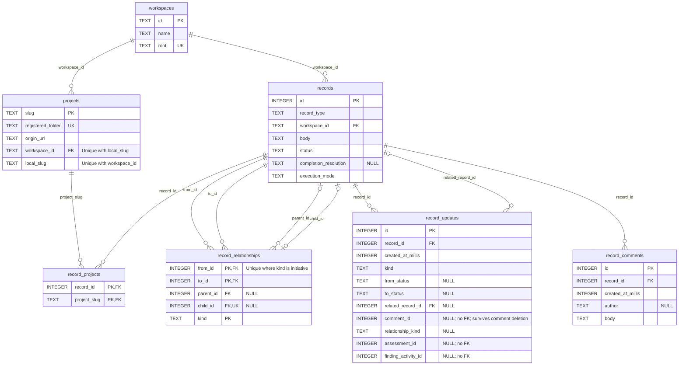
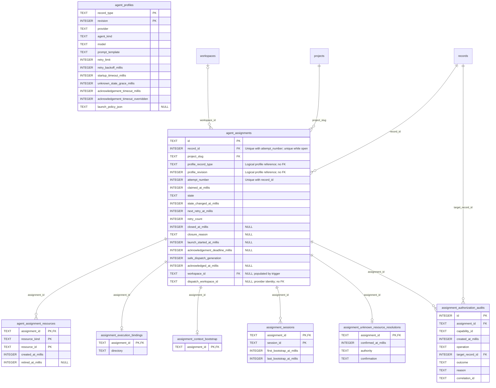
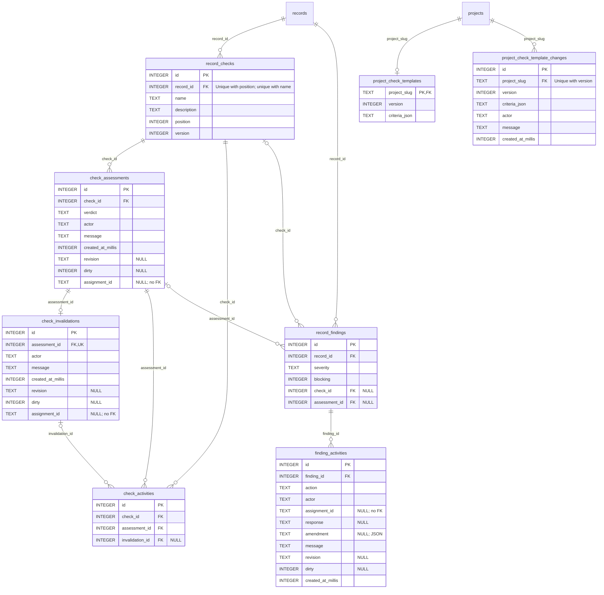

# Store database structure

`forge-store` implements the application's persistence boundary using SQLite.
This is a reference for the schema after initialization, including columns added
by migrations—not just the initial `CREATE TABLE` statements.

## Source of truth

- [`src/lib.rs`](src/lib.rs): `SqliteProjectRepository::from_connection`,
  `migrate_*` functions, profile seeds, and repository operations.
- [`src/workspaces.rs`](src/workspaces.rs): Workspace ownership and Project identity.
- [`src/upgrade.rs`](src/upgrade.rs): explicit offline schema 7 → 8 → 9 → 10 → 11 → 12 → 13 → 14 → 15 → 16 → 17 → 18 → 19 → 20 → 21 → 22 conversion,
  frozen contract validation, consistent snapshots, and preservation inventories.
  See [Revision State upgrades](../../docs/state-upgrades.md) for orchestration.
- [`src/record_workspaces.rs`](src/record_workspaces.rs): Record ownership,
  cross-Workspace guards, and update-history migration.
- [`src/checks.rs`](src/checks.rs): Task Checks, Assessments, Invalidations,
  activity history, and completion gating.
- [`src/findings.rs`](src/findings.rs): Task Findings and retained review cycles.
- [`src/execution_modes.rs`](src/execution_modes.rs): explicit policy handoff,
  atomic ownership/resource gates, mode-change history and start authorization.
- [`src/check_templates.rs`](src/check_templates.rs): Project Check Templates,
  replacement history, and Task provisioning.
- [`src/workspace_dispatch.rs`](src/workspace_dispatch.rs): Workspace dispatch
  configuration, provider generations, and Assignment binding.
- [`src/durable_execution.rs`](src/durable_execution.rs): durable runtime identity,
  admission intent/results and conservative capacity reservation (schema 20),
  append-only authorization grant history (schema 21), and identity-bound
  revoked retirement reconciliation (`src/durable_execution/retirement.rs`, schema 22),
  plus follow-ups, runtime purge journal and sticky launch rollback (schema 23), and
  recorded purge removal outcomes (schema 24).
  Runtime conversations live in separate per-Assignment stores, not this database; see
  [Durable Task execution](../../docs/durable-execution.md).

Keep this reference in sync when those schema definitions change. Domain behavior
is documented separately in [Records](../../docs/records.md),
[Workspaces](../../docs/workspaces.md), and [Dispatcher](../../docs/dispatch.md).

## Storage conventions

- Foreign-key enforcement is enabled on repository connections.
- `TEXT` stores identifiers, paths, bodies, enum values, and serialized JSON;
  `INTEGER` stores numeric IDs, counters, timestamps, and boolean flags.
- `*_at_millis`, `*_until_millis`, and deadline timestamps are Unix epoch
  milliseconds; timeout/backoff/grace fields are durations in milliseconds.
- Below, `?` means nullable; otherwise columns are `NOT NULL`, except the SQLite
  integer primary keys named `singleton` (which have no explicit `NOT NULL`).
  `PK`, `FK`, and `UNIQUE` describe database constraints.
- Integer `id` primary keys use SQLite rowid allocation; there is no
  `AUTOINCREMENT` declaration. Record IDs are global within the database, not
  numbered separately per Workspace.
- Foreign keys use SQLite's default delete behavior unless stated otherwise.
  Most references do **not** cascade.
- Ordinary repository opening accepts only the current marked schema revision **22**.
  Triggers and repository validation also enforce invariants. Explicit managed
  copy-and-upgrade targets revision 22 from revisions 7 through 22; unsupported
  stores are rejected without automatic conversion or reset.

## Durable recovery episodes (existing revision 22 representation)

Recovery uses the existing opaque Assignment resource ledger: `recovery-claim`
retains a content-bound Candidate commitment, operation ID, fresh issuer epoch and
original Launch; `recovery-grant` retains the exact committed fresh lease and
protected external-proof digest. Neither contains Task bodies, capabilities,
provider credentials or transcript/tool payloads. Runtime proof files remain in
separate owner-only runtime storage, not this database.

Immediate writer transactions enforce at most one active claim per Assignment,
immutable operation identities, scope-before-replay and live original-binding
revalidation. Grant insertion, audit acceptance and claim retirement commit
atomically. Exact historical claim retries return their original fence only;
retired/cancelled claims cannot issue authority. A subsequent recovery requires a
changed current predecessor commitment and a different operation/epoch, preserving
all earlier claims/grants. Readers reject malformed/duplicate histories and validate
each historical grant against its actual retained predecessor before accepting a
new episode. Ordinary grants cannot bypass an active recovery fence. No attempt,
freshness, evidence or Continuation budget is changed by these operations.

There is no new table/column, schema marker rewrite, backfill or automatic conversion.
This extends policy over resource rows already representable in revision 22;
earlier prototype binaries may conservatively refuse operations on multi-episode
histories. Use matched components; this is not an installed-release compatibility
or rollout claim. Original admission remains immutable. Accepted Check handoff
uses known bound durable admission rather than requiring Herdr `agent-name`
metadata, but that only permits revocation/cleanup to begin, never capacity release.

## Durable retirement reconciliation (revision 22)

`durable_assignment_retirements` stores one immutable `operation_json` per
`assignment_id` (PK/FK to the retained durable runtime) and nullable
`reconciled_at_millis`. The operation binds the original Launch, retirement ID,
host/worker starts, boot/time namespace and kernel lock identity. Identity/delete
triggers retain intent; a non-null result timestamp is immutable. No credential,
command, transcript or prompt is stored here.

The trusted retirement port requires owning scope, exact retained binding,
revocation and a known admission result before accepting intent or replay. New
intent must match original ownership in the retained authorization grant; a fresh
lookalike cannot replace the original executor. After external cleanup, the caller
holds exclusive host inspection while reading the protected exact receipt,
retaining committed interrupted effects with the matched read-only inspector,
and committing reconciliation. An immediate transaction
records the timestamp and retires only application-approved bound runtime and
known execution-liveness diagnostics; any failed write rolls back both. A runtime
resource trigger requires a matching accepted retirement result and revoked
Assignment before releasing its marker. External effects, unknown provisioning,
unrecognized diagnostics and the operator Dispatch Hold are preserved. Generic
retirement finalization still requires all other resources reconciled.

A read-only revoked-grant snapshot also supports reconciliation from an original
subreaper's exact-grant crash receipt. Scope, immutable runtime and revocation are
checked in one snapshot; this lease is historical identity, not renewed permission.
The trusted adapter must independently prove exclusive ownership and descendant
absence, reject later host-fault markers and inspect committed effects before the
same transactional reconciliation. It writes no synthetic host retirement receipt.

Ordinary opening rejects revision 21 before initialization writes. Explicit
offline 21 → 22 adds an empty retirement journal and replaces the runtime resource
retirement guard; it fabricates no historical ownership or cleanup proof and does
not permit upgrading through unresolved execution blockers. Runtime schema and
runner wire v1 are unchanged; the separate private retirement control is version 1.
See [Assignment recovery](../../docs/assignment-recovery.md#durable-supervised-retirement-controlled-implementation).

## Assignment authorization grant history (revision 21)

`assignment_authorization_leases` stores `(assignment_id, sequence)` as its primary
key, with an Assignment runtime FK and typed `lease_json`. Update/delete triggers
retain the complete grant history. Grants bind the immutable Launch, work
generation, host/worker start identities, lock identity, host boot/time namespace,
daemon lifetime epoch and sequence. Only a trusted internal daemon adapter may
supply verified ownership and clock observations; no agent/operator wire method
currently exposes this repository operation.

Grants last 30 seconds; the daemon-side renewal service uses a 10-second cadence. Deadlines use
absolute host CLOCK_BOOTTIME milliseconds, **not Unix epoch time**. The application
policy rejects changed bindings/owners/epochs, sequence gaps, future issuance,
non-30-second bounds and renewals at or after the previous deadline. Exact retries
return no new deadline, require current authority, and reject expiration. A daemon
restart cannot renew a previous lifetime's grant or reset its sequence.

An immediate transaction revalidates scope, live Assignment/attempt state, profile
and runtime identity, freshness, Spec/Stack/dependency execution gates, Execution
Mode, Dispatch Holds and unresolved resource blockers before recording a grant.
Grant persistence never acknowledges a capability, starts a Task, records a
heartbeat, accepts an Outcome or releases a capacity reservation. Expiry alone
does not prove that execution stopped. No secrets belong in grant history.

Revision 21 rejects older stores before ordinary initialization writes. Explicit
offline 20 → 21 conversion adds only an empty grant table and its history guards;
it creates no historical permissions. The T05 controlled runtime now includes
verified host ownership, a commit-before-delivery renewal service, consumer guards
and an independent watchdog. Production Check-bound dispatch remains disabled;
profile/authentication mapping and the dispatch/bootstrap tracer are T06/T07.

Authorization uncertainty uses the existing generic resource representation, not
new DDL or invented grant history. The trusted `SessionRepository::retain_failure`
operation checks owning Workspace and exact retained Launch, then atomically adds
an `authorization-uncertain` resource (fixed redacted cause code as resource ID)
and an initial Dispatch Hold. It works after closure/freshness invalidation,
preserves an existing hold, and exact retries preserve resource timestamps. It
never retires resources, clears history, closes an attempt or releases capacity.
Those unresolved resources also prevent future grant issuance. A failed retention
transaction rolls back both effects; the prior durable-runtime reservation still
reserves capacity when persistence is unavailable. This additive use of existing
resource/hold contracts does not change schema 21.

Interrupted effects likewise use an additive resource kind, `interrupted-effect`.
Its opaque `resource_id` is canonical serialized `InterruptedEffect` identity
(`task_id`, `conversation_id`, `call_id`), not command text, arguments or output.
The trusted `durable_execution::effects::Repository` boundary checks owning scope
and exact retained Launch before retry, then atomically retains bounded identities
and a Dispatch Hold without overwriting another hold. A task identity cannot be
reused with conflicting call/conversation identities. At most 1,000 distinct
identities are accepted per runtime; overflow rejects the whole transaction.
Exact retries preserve original timestamps, and empty/later observations do not
resolve prior uncertainty. Delayed observations after closure/invalidation or a
lost admission reply remain retainable. Accepted Outcomes are untouched. These
resources reserve capacity and independently block lease issuance even after hold
clearance. Generic resource retirement rejects this kind: provider cleanup cannot
resolve an external outcome.

The internal `effect_resolution::Repository` boundary accepts evidence-based
trusted operator assertions for live or closed Assignments. Live acceptance keeps
the effect resource as an execution fence; it neither revokes nor renews authority.
Only closed acceptance retires the selected effect. For new
acceptance, the server's `resolve_exclusive` adapter obtains the existing host
lock and performs fresh committed inspection, retaining the guard throughout the
commit. Original accepted-result reads authorize Workspace/Launch in a consistent
read transaction and admit nothing; they require no current host owner, runtime
storage or matching inspector. Conflicting reuse still rejects.
Both explicit safety confirmations and host ownership are required; the lock is
not proof that escaped external children stopped.
Supported conclusions are `applied` or `not-applied`; unknown stays unresolved.
An immediate transaction checks scope and the complete Launch before replay,
returns the original receipt for an exact operation, and rejects conflicting
operation/effect reuse. Acceptance atomically applies the app-owned live/closed
disposition and inserts an already-retired `interrupted-effect-resolution` audit
resource, whose canonical JSON ID retains attribution, evidence reference,
explanation and confirmations. Its creation/retirement timestamps are identical
and supply the original acceptance time. At most 1,000 audits exist per runtime.
Generic resource insertion/retirement cannot forge or rewrite these audits.
Re-observation preserves the original effect disposition and audit. Live fences
still block lease issuance after hold clearance or later closure; exact replay
cannot turn a live audit into closed resource retirement. Holds, other
resources, Outcomes and runtime receipts are untouched; audit resources do not
reserve capacity themselves. Evidence fields are ordinary operational output:
never place tool payloads, credentials or prompts there.

The controlled public `assignment-resolve-effect` CLI and
`agentDispatch_assignmentResolveEffect` RPC wrap this boundary. The server derives
Launch and canonical storage from the selected Workspace/Assignment, never caller
paths or a mutable current profile. New acceptance requires explicit trusted
matched inspection components on the host; accepted-result reads remain available
without them. These are operator operations, not Assignment capability actions.
Runtime interruption remains visible in protected storage and still rejects
writable recovery; no accepted runtime result is manufactured. Live/same-Assignment
external resolution preserves the attempt without permission to resume. The daemon's
`bind_inspected` grant-controller boundary retains committed effects before any
initial grant under verified directly spawned ownership. The synchronous `bind`
is fresh-only and rejects existing SQLite storage/sidecars and missing accepted
storage. Inspection failures retain authorization uncertainty/capacity. Safe writable
recovery and automatic scheduling remain later deliverables. See
[T08 evidence](../../docs/research/pi-durable-t08/README.md).
No schema, runner component or existing serialized field changes are required;
these are additive opaque resource kinds, a new CLI/RPC operation and internal
Rust service interfaces.

The server's preparation/binding path derives protected storage at
`<workspace-root>/.forge/assignment-runtimes/<sha256(store_id)>` from the exact
retained runtime and immutable registered root, never an operator path. Missing
or unsafe binding paths cannot silently create/adopt a runtime. Runtime watchdog
files supplement these Forge diagnostics; neither file deletion nor process exit
resolves persisted resources. See [T05 evidence](../../docs/research/pi-durable-t05/README.md)
for fake-clock and real SQLite/daemon-service/host/Node outage tests and remaining
production/release gates.

## Recovery reservations (controlled T10 increment)

The internal `durable_execution::recovery::Repository::claim_recovery` port
atomically revalidates a candidate and reserves one `recovery-claim` opaque
Assignment resource. Its JSON identity retains the exact Launch, bounded operation
and daemon identities, and SHA-256 of the complete typed candidate; Task bodies
and handoffs are not copied into resource diagnostics. Scope/binding authorization
precedes historical replay. Exact retries preserve the original identity and
timestamp even after revocation; competing operations/epochs or changed candidates
reject. The immediate transaction serializes independent claimants and commits no
attempt, Outcome, evidence, admission or grant changes.

This resource retains capacity and fences ordinary grants, including old-owner
renewal. It is **not** a recovery lease, process cleanup proof or permission to open
runtime storage. Generic resource insertion/retirement cannot create or consume
it. No timeout, restart or retired history permits takeover. Verified revoked
retirement may cancel a validated claim matching the exact Launch, atomically
with its original-owner cleanup receipt and runtime reconciliation. Malformed or
foreign claims fail closed and roll back the entire reconciliation. Claim identity,
creation timestamp and original-result replay survive cancellation; effects,
unknown resources and holds are not discharged. No production daemon or public
CLI/RPC path creates a claim. Automatic recovery remains disabled.

The internal `recovery::authorization::Repository::grant_recovery` transition
accepts an opaque application-owned `Prepared` value constructed only after a
trusted `RecoveryHost` verification boundary. That boundary must retain protected
external safety evidence keyed by claim operation; a digest links the audit to
that proof, not proof of death by itself. No concrete recovery verifier or delivery
controller is implemented yet. The store revalidates the full claimed candidate
and every live gate inside an immediate transaction. Only the exact recovery claim
is exempted from resource blocking; holds, effects and unrelated resources remain.
Acceptance commits the next Assignment-wide lease sequence, a retired
`recovery-grant` audit (claim, new lease and evidence digest), and claim retirement
together. Original attempts, admissions, bound context and other tables are unchanged.
The new lease uses a freshly verified waiting owner and the claim's new daemon epoch;
it is not renewal of the old owner's expired deadline. Exact live retries preserve
the original deadline/audit; expiry, revocation, binding drift or later renewal
reject delivery replay without rewriting history. Generic resource operations
cannot create/retire either recovery resource kind. Existing ordinary consumers
reject a first grant above sequence one; the specialized handshake remains missing.
The current single-claim history also conservatively blocks subsequent recovery
operations. See [T10 authorization evidence](../../docs/research/pi-durable-t10/recovery-authorization.md). No DDL/schema
or public wire changes are required for this additive opaque resource kind; older
grant/readiness checks already block unknown retained resources. See
[T10 reservation evidence](../../docs/research/pi-durable-t10/recovery-reservation.md).

## Durable runtime admission (revision 20)

`durable_assignment_runtimes` has one row per Assignment (`assignment_id` PK/FK).
`backend` is explicitly `pi-durable`. Unique `operation_id`, `runtime_id`,
`conversation_id` and `store_id` prevent reuse across Assignments.
`launch_json` retains the complete typed, immutable launch: Assignment/Check attempt,
profile revision, execution incarnation, runtime/conversation/store identities,
Forge Revision, matched component hash and runtime schema (initially 2).
Store IDs are opaque identities, not operator-supplied filesystem paths; this
reservation does not create or open runtime storage. Runtime layout and host
ownership are subsequent runner work.

The launch's canonical typed fields are compared in full, not merely operation ID
or a lossy fingerprint. Exact retries return the originally accepted result;
conflicts reject. `admission_json` is typed `pending`, `unknown`, `accepted` (original
admission ID) or `rejected` (structured code). Accepted/rejected results cannot be
replaced through the repository. Scope and immutable Check/profile binding are
validated before replay, independent of current Workspace selections.

An immediate transaction reserves identity and a `durable-runtime` Assignment
resource together. Exactly one sender changes pending to unknown **before** the
external call. Unknown retries only observe the original admission, never blindly
send again; an unobserved request remains uncertain even if it never reached the
runner. Transport failures and failed result commits retain unknown across reopen.
Result commit revalidates scope/binding, including for a late reply after closure;
recording that reply does not restore authority or release capacity. A terminal
runtime response is not an Outcome or Check Assessment.

The existing resource guards retain capacity, replacement/worktree blockers and
historical backend identity even for closed Assignments. SQL guards prevent generic
resource retirement/deletion from clearing the durable marker. No durable cleanup
or safety override is implemented here: verified retirement is later work. A
rejected admission alone is not proof of host-process absence. All external calls
are outside writer transactions. No credentials, prompts or model responses belong
in launch identity or result diagnostics.

Revision 20 is a breaking storage contract. Ordinary open rejects incompatible
stores before initialization writes. The separately requested offline 19 → 20
upgrade adds only empty runtime tables/guards, preserving all historical rows and
inventing no backend/runtime identities. Older explicit upgrade paths compose this
expansion. Durable dispatch remains disabled; protocol definitions and fake
transport tests do not establish production runner or recovery readiness.

## Retained-work salvage authorization (revision 17)

`retained_work_recoveries` stores `source_assignment` (PK, FK to
`agent_assignments.id`), `record_id` (FK to `records.id`) and `recovery_json`.
Update/delete triggers retain immutable authorization. JSON includes selected
Repository evidence, source Assignment, expected generation, actor, explanation,
both explicit safety assertions, canonical worktree path, Check identity, resulting
generation and timestamp. One source Assignment permits one authorization; exact
retries return its original result and conflicts reject atomically.

An immediate transaction revalidates Task/Check/scope, latest source, explicit
retirement and all resources, active canonical claim/Repository and freshness.
Authorization, freshness invalidation, selected work input and retained hold commit
together. No Check passes, Continuation is invented, budget resets, or Stack pins
change. Historical outcomes, Assessments and Findings remain. External Git identity
and retained-state observations run outside the transaction. The next matching
Implementation attempt captures `recovery` context; work inspection returns the
durable `recoveries` audit. Added JSON fields default null/empty when absent from
historical accepted results, which are never rewritten.

Revision 17 is a breaking safety/storage expansion. Ordinary opening rejects older
stores before writes. Explicit isolated offline upgrade adds an empty table with
no historical authorization or adoption, preserving all existing typed values.
Same-schema transfers retain real audits. Drift reconciliation now invalidates and
holds without adopting the unexpected observed commit; hold clearance cannot make
unexplained work trusted input. See [Assignment recovery](../../docs/assignment-recovery.md)
for the separate trusted operator interface.

Revision **18** adds content-bound dirty/staged/untracked salvage. SQL tables are
unchanged, but this is a breaking semantic safety contract: older dispatchers must
not ignore dirty-state identity. `recovery_json.retained_state` defaults null for
historical clean authorizations; dirty authorization stores `{sha256}` binding
HEAD, index entries/stages/flags, paths, modes and working bytes. It is not ordinary
clean commit evidence. The application revalidates this identity before the first
successor claim; the exclusive durable Assignment reservation consumes this input
exception and prevents duplicate launches after restart. Output observation remains
strictly clean. Upgrade 17 → 18 only advances the marker in an explicit transaction,
preserving all JSON/history/counters exactly without inventing fingerprints or
recovery events. Ordinary opening rejects older markers before writes.

Revision **19** fences corrected checkpoint/salvage identity validation and the
`forge-retained-state-v2` fingerprint, which includes extended Git index flags
(such as intent-to-add) but excludes mutable stat-cache fields. Clean and dirty
salvage both revalidate canonical Repository, branch and Base Commit before the
first successor. Clean outcome observations use the same identity checks;
untracked-file configuration cannot hide work, and index trust flags conservatively
require dirty salvage. SQL and JSON shapes are unchanged. Explicit 18 → 19 upgrade
preserves every stored value and advances only the marker. Historical v1 dirty
fingerprints are not rewritten or reauthorized; they fail closed at dispatch.
Exact retries still return their original audit, so an unconsumed old dirty
recovery has no automatic reauthorization path. Preserve it for separately approved
operator recovery design rather than editing storage or discarding evidence.

## Continuation resets (revision 16)

`check_continuation_resets` is append-only through supported operations: `id` PK,
`check_id` FK to `record_checks`, nonblank `actor` and `message` validated at the
application/persistence boundary, and `created_at_millis`. Explicit operator reset
atomically sets only the selected Check's total and consecutive-unchanged counts
to zero and inserts the audit row. Checkpoint/handoff and historical outcomes,
holds, remediation/interruption budgets and resource/ownership state are retained.
Inspection includes the full reset history ordered by audit id, not a truncated page.
Concurrent resets serialize; audit failure rolls back both effects.

Revision 16 is breaking: `check_continuations.total` now permits zero. Ordinary
opening rejects schema 15 and earlier before writes. Explicit offline upgrade
rebuilds the counter table preserving all existing typed values/checkpoint bytes,
and adds an empty audit table without invented resets. Same-schema transfers
retain actual history. Wire additions are compatible for permissive decoders:
`CheckContinuations.resets` defaults empty for old stored JSON; strict older clients
must coordinate CLI/server upgrades. Historical accepted results are never rewritten.

## Implementation Continuations (revision 15)

`check_continuations` stores one row per stable Check: `check_id` is its primary
key and FK to `record_checks`; `total` is constrained to 0–20 (1–20 in revision 15);
`consecutive_unchanged` to 0–2; `checkpoint_json` contains accepted attempt id,
Repository evidence and full structured handoff. Acceptance updates these fields,
`record_work.input_json` (clearing output), closed attempt request/result and any
limit-triggered Dispatch Hold in one immediate transaction. No Assessment is added,
no Finding cleared, and immutable Stack Base Commit is untouched. Historical
checkpoint requests/results remain in `record_attempts`; the counter row retains
the latest checkpoint. Each successor's immutable `attempt_json` captures its
handoff context. New serialized fields have absent-field defaults for decoding
historical results, not fabricated historical handoffs.

Claim, evidence reconciliation and completion recreate exhausted continuation holds;
ordinary resume retains/reinstates them. Remediation resets, invalidation and body
edits never change continuation counters. Existing safety hold reasons win through
`INSERT OR IGNORE`. Exact replay returns the original accepted result before live
freshness checks and never spends the budget again.

Revision 15 is a breaking storage expansion: old writers cannot enforce the new
checkpoint and budget semantics. Ordinary opening rejects revision 14 and earlier
before initialization writes. Explicit offline staging upgrade adds an **empty**
table and preserves every pre-existing typed value and historical JSON byte-for-byte.
It does not infer Continuations from prior failures/interruptions or reset existing
budgets. Same-schema transfer retains continuation counters, handoffs and replay.
No live conversion is performed by application opening.

## Assignment session provenance (revision 14)

`assignment_sessions` retains successful bootstrap observations. Its composite
primary key is `(assignment_id, session_id)`; `assignment_id` references
`agent_assignments.id`. First and latest observation timestamps are Unix
milliseconds, not session start/end or liveness evidence. Registration atomically
requires an open, acknowledged Assignment, an In Progress Record and trusted
context evidence. Retries update only the latest timestamp; associations remain
with closed Assignment history.

Revision 14 expands the storage contract. Ordinary opening rejects older schemas
before writes. The explicit offline staging upgrade adds an empty table without
inventing session history or modifying existing facts. Same-schema upgrade retains
all existing session associations.

## Canonical Builds-On topology (revision 12)

`builds_on_dependencies` designates the code-consuming kind of a shared prerequisite
row. It is the single authoritative immediate predecessor for canonical chains:

| Column | Type / constraint |
| --- | --- |
| `from_id` | INTEGER PK; blocked Task, at most one code input |
| `to_id` | INTEGER NOT NULL UNIQUE; prerequisite Task, at most one successor |
| `kind` | TEXT NOT NULL DEFAULT `depends-on`, constrained to that value |

The composite FK `(from_id, to_id, kind)` references `record_relationships` with
`ON DELETE CASCADE`; a CHECK rejects self-links. Application policy plus writer
transactions enforce same-Project Task endpoints, mutually exclusive intent,
shared cycle/readiness checks, Open/unprepared affected suffixes, and started-Spec
restrictions. Relationship, designation, execution-state initialization and audit
commit atomically. Public reads expose `builds-on`, not the compatibility row kind.

Canonical successors retain an evidence row in `task_stacks` with NULL predecessor
and `{}` source JSON: it carries no mutable topology or competing root destination.
Reads derive the predecessor and inherited destination from the relationship.
Only roots retain repository/remote/selected branch configuration. Legacy Stack
predecessor declarations are rejected with `record relate --kind builds-on`
replacement guidance. Historical row decoding remains for explicit offline upgrade
inspection; conversion removes independent topology before target activation.

Revision 12 is a breaking storage-contract expansion. Ordinary opening rejects
revision 11 before writes. Explicit offline expansion adds an empty designation
table without inferring historical intent or rewriting pins, history, or Checks.
This historical expansion alone did not convert intent.

### Validated prerequisite intent (revision 13)

Revision 13 is a **semantic** storage-contract break with the same frozen DDL as
revision 12. Ordinary opens reject 12 and earlier before writes. Only the explicit
staging upgrade may stamp 13, in the same transaction as conversion and validation.

- Legacy `task_stacks.predecessor` pairs become `builds_on_dependencies` rows;
  the successor's predecessor becomes NULL and source JSON becomes `{}`. The
  associated prerequisite row is retained, not duplicated. Every decoded Stack
  before/after conversion must be identical, including destination, prepared pin,
  publication and unchanged results.
- Existing ordering-only designations remain Waits-For. Indirect Stack-ancestor
  prerequisites and other permitted ordinary prerequisites gain Waits-For
  designations, preserving every direct completion constraint.
- Other same-Spec ordinary Task prerequisites are unresolved. Diagnostics name
  each blocked/prerequisite pair. `forgeup upgrade prepare --waits-for-decisions`
  accepts explicit completion-only decisions for Open, unprepared Tasks under an
  Open Spec. It cannot replace known intent or bypass lifecycle restrictions.
  Code-inheritance decisions must first be declared through the source revision's
  public Stack workflow; migration never prepares work, creates branches, or
  invents result evidence.

Conversion checks shared cycles, endpoint/scope eligibility, linear topology,
canonical designation exclusivity, decoded Stack equivalence, prepared commit
pins and persisted predecessor/result authorization. SQLite integrity and frozen
schema checks remain mandatory. Every other pre-existing table's complete typed
inventory is unchanged, including prerequisite rows, historical Updates and
Comments, immutable Checks, attempts, work results, forced completions, ownership,
retry counters and Dispatch Holds. Failure rolls back the entire staging chain;
Forgeup never publishes or activates an unvalidated copy. External hosting is not
queried offline: normal authorization still re-observes it before execution.
Incomplete Open Builds-On lineage without preparation or result evidence may
retain missing root/successor configuration through conversion and same-schema
transfer. Offline inspection validates topology and stored source configuration,
not execution completeness for such plans. It never supplies missing execution
configuration or relaxes ordinary execution authorization; started or evidenced
lineage still requires complete configuration and retained-evidence validation.

## Forced completion evidence (revision 11)

`src/completion.rs` adds `forced_completions` without rewriting historical Records:

| Column | Type / constraint |
| --- | --- |
| `record_id` | INTEGER PK, FK → `records(id)` |
| `update_id` | INTEGER UNIQUE, FK → `record_updates(id)` |
| `actor` | nonblank TEXT; existing operator authority attribution |
| `resolution` | nonblank TEXT; supplied Completion Resolution |
| `bypassed_gates_json` | TEXT; array of transaction-time `{code, message}` workflow denials |

The row's presence is the explicit forced marker. The linked Update supplies its
immutable timestamp and original status transition. Status, resolution, Update,
and evidence insert commit together under an immediate writer transaction.
Ordinary/historical completions have no row; already-Done force creates none.
Revision 11 adds this table through explicit copy-and-upgrade, preserving every
old table and frozen schema contract without backfilling completion evidence.
Ordinary opening rejects older stores before initialization writes.

## Waits-For compatibility representation (introduced in revision 9)

Canonical `waits-for` uses the existing `depends-on` row plus its explicit
`ordering_only_dependencies` designation. Application reads expose `WaitsFor`;
readiness and cycle SQL continue to traverse all persisted prerequisite rows.
Removal checks the designation in the same transaction as deletion and history.
The public cutover changes no storage revision or Management Protocol. Historical
Update kinds remain unchanged; new designation Comments use Waits-For vocabulary.
CLI, RPC and Application declarations reject legacy prerequisite names. Public
inspection exposes canonical `kind` without the former `ordering_only` wire flag;
that flag remains an internal representation, not an alternative intent model.
Historical conversion uses the separate explicit offline upgrade path.

`ordering_only_dependencies` persists explicit intent without changing ordinary
`record_relationships` rows or readiness ordering:

| Column | Type / constraint |
| --- | --- |
| `from_id` | INTEGER, composite PK; blocked Record |
| `to_id` | INTEGER, composite PK; prerequisite Record |
| `kind` | TEXT, constrained to `depends-on` |

The composite FK `(from_id, to_id, kind)` references `record_relationships` and
uses `ON DELETE CASCADE`, so removal cannot leave orphaned designations. Absence
means no explicit exception, not code inheritance. Creation validates normal
dependency scope and lifecycle, rejects Stack Predecessor contradictions, and
records Relationship updates plus designation comments atomically. Changing
intent uses supported dependency removal and recreation while Open; a Stack
Predecessor dependency cannot be removed independently. Upgrades add an empty
table and preserve all old tables and pins without inventing designations.

## Unchanged publication results (revision 10)

`task_unchanged_results` adds an alternative to PR-shaped `task_stacks.publication_json`:

| Column | Type / constraint |
| --- | --- |
| `record_id` | INTEGER, PK and FK to `task_stacks(record_id)` |
| `evidence_json` | TEXT; serialized `UnchangedResult` with repository evidence and generation |

Only one current publication alternative is retained per Task. Acceptance validates
exact prepared/output commit equality, generation, all preceding Checks and Manual
ownership or the bound final Check Assignment in one transaction with audit history.
The application independently observes a clean checkout before recording unchanged
evidence and again at completion. Verification does not itself pass a Check: the
ordinary evidence-bound Publication outcome is still required. Invalidation makes
old evidence unusable; re-verification in a later generation replaces current
publication evidence while retaining audit history. Upgrade adds an empty table,
without inventing results or rewriting existing PR evidence, Checks, or pins.

## Entity Relationship Diagrams

These four views describe the core tables. The snapshot and Manual outcome
additions are documented in the appendices below. Boxes without attributes are
references to a table defined in another view, not incomplete definitions.

- Attribute comments beginning with `NULL` mark nullable columns. All other
  attributes are nonnullable in a fresh store (including SQLite integer primary
  keys). Incompatible older schemas are rejected; see below.
- `PK` marks primary-key membership; multiple `PK` attributes form one composite
  key. `FK` marks foreign-key membership. `UK` marks a single-column unique key;
  composite and partial unique indexes are annotated separately.
- Each edge represents a declared foreign key, not an application-level
  association. Crow's-foot notation: `||` = exactly one, `o|` = zero or one,
  `o{` = zero or many. Nullable foreign keys make the referenced entity optional.
- Defaults, enum/check constraints, triggers, and migration details remain in the
  table reference below to keep the diagrams readable.

### 1. Workspaces, Projects, and Records



### 2. Agent profiles, Assignments, and audits

`workspaces`, `projects`, and `records` are reference-only boxes defined in view 1.
Assignment profile columns are logical references: no FK connects Assignments to
`agent_profiles`.



### 3. Dispatch configuration and worktrees

`workspaces`, `projects`, and `records` refer to view 1; `agent_profiles` refers
to view 2. Profile-selection edges each represent a **composite** FK.
`agent_dispatch_configuration` and `dispatch_provider_generation` are standalone
singletons coordinated by triggers, not a foreign key. Generation verification
and provider identities also have no FK edges.

```mermaid
erDiagram
    project_managed_worktree_configuration {
        TEXT project_slug PK,FK
        TEXT setup_hook
    }
    worktree_claims {
        INTEGER record_id PK,FK
        TEXT project_slug FK
        TEXT path UK
        TEXT state
    }
    project_agent_dispatch_configuration {
        TEXT project_slug PK,FK
        INTEGER task_concurrency_limit
    }
    dispatch_holds {
        INTEGER record_id PK,FK
        TEXT reason
    }
    task_base_commits {
        INTEGER record_id PK,FK
        TEXT base_commit
    }
    agent_dispatch_configuration {
        INTEGER singleton PK
        TEXT herdr_socket_path "NULL"
        TEXT dispatch_workspace_id "NULL; legacy; no FK"
        TEXT dispatch_workspace_root "NULL; legacy"
        TEXT scan_lease_owner "NULL"
        INTEGER scan_lease_until_millis "NULL"
    }
    workspace_dispatch_configuration {
        TEXT workspace_id PK,FK
        TEXT task_profile_type FK "Composite FK with task_profile_revision"
        INTEGER task_profile_revision FK "NULL"
        TEXT grilling_profile_type FK "Composite FK with grilling_profile_revision"
        INTEGER grilling_profile_revision FK "NULL"
        TEXT herdr_workspace_id UK "NULL; provider identity"
        INTEGER verified_generation "NULL; logical generation reference; no FK"
    }
    dispatch_provider_generation {
        INTEGER singleton PK
        INTEGER generation
    }
    workspace_profile_preflight_blockers {
        TEXT workspace_id PK,FK
        TEXT record_type PK
        INTEGER profile_revision "No FK"
    }

    projects ||--o| project_managed_worktree_configuration : project_slug
    projects ||--o| project_agent_dispatch_configuration : project_slug
    projects ||--o{ worktree_claims : project_slug
    records ||--o| worktree_claims : record_id
    records ||--o| dispatch_holds : record_id
    records ||--o| task_base_commits : record_id
    workspaces ||--o| workspace_dispatch_configuration : workspace_id
    workspaces ||--o{ workspace_profile_preflight_blockers : workspace_id
    agent_profiles o|--o{ workspace_dispatch_configuration : task_profile
    agent_profiles o|--o{ workspace_dispatch_configuration : grilling_profile
```



### 4. Checks, Assessments, Findings, and Templates

`records` and `projects` refer to view 1. Attribution through `assignment_id`
is retained text, not an FK to `agent_assignments`. Record update pointers to
Assessments and Finding activities also have no FKs.



## Workspaces and Projects

### `workspaces`

| Column | Type / constraint |
| --- | --- |
| `id` | TEXT, PK |
| `name` | TEXT, trimmed value must not be empty |
| `root` | TEXT, UNIQUE |

Triggers prevent updates to `id` or `root`. Canonical filesystem boundaries are
validated by application code, not by SQLite.

### `projects`

| Column | Type / constraint |
| --- | --- |
| `slug` | TEXT, PK; immutable persistence reference |
| `registered_folder` | TEXT, UNIQUE; canonical main checkout root |
| `origin_url` | TEXT |
| `workspace_id` | TEXT, FK → `workspaces.id`, ON DELETE RESTRICT |
| `local_slug` | TEXT; operator-facing Workspace-local slug |

`workspace_project_slugs` uniquely indexes `(workspace_id, local_slug)`.
Despite its name, `projects.slug` is the persistence identity referenced by all
`project_slug` columns; it is not necessarily the local slug. Operator routing
uses Workspace plus `local_slug`.

Triggers require ownership and a nonblank local slug on insert, and prohibit
updates to `slug`, `registered_folder`, `workspace_id`, or `local_slug`.

## Records, scope, and history

### `records`

| Column | Type / constraint |
| --- | --- |
| `id` | INTEGER, PK |
| `record_type` | TEXT: `generic`, `spec`, `task`, `wayfinder`, `grilling`, `initiative` |
| `workspace_id` | TEXT, FK → `workspaces.id`, ON DELETE RESTRICT |
| `body` | TEXT |
| `status` | TEXT: `open`, `in_progress`, `done` |
| `completion_resolution` | TEXT? |
| `execution_mode` | TEXT: `manual`, `dispatched`; SQL default `manual`, Task provisioning selects `dispatched` when Project-scoped |

`workspace_records` indexes `(workspace_id, id)`. Triggers require ownership on
insert and prevent Workspace changes. Type applicability, lifecycle rules,
and completion semantics are enforced by repository/application code.

### `record_projects`

- `record_id INTEGER`, FK → `records.id`.
- `project_slug TEXT`, FK → `projects.slug`.
- Composite PK: `(record_id, project_slug)`.

Represents a Record's Project scope, including multi-Project Records. A Record
with no rows here still belongs to a Workspace. An insert trigger rejects
cross-Workspace scope; an update trigger rejects all updates to these rows.

### `record_relationships`

| Column | Type / constraint |
| --- | --- |
| `from_id` | INTEGER, FK → `records.id` |
| `to_id` | INTEGER, FK → `records.id` |
| `parent_id` | INTEGER?, FK → `records.id` |
| `child_id` | INTEGER?, FK → `records.id`, UNIQUE |
| `kind` | TEXT: `parent-child`, `depends-on`, `generated-by`, `initiative` |

Composite PK: `(from_id, to_id, kind)`. Direction is child → parent for
`parent-child`, dependent → prerequisite for `depends-on`, generated Record →
source for `generated-by`, and member → Initiative for `initiative`.
`parent_id` and `child_id` support hierarchy constraints; non-hierarchy links use
nulls. The unique `child_id` permits at most one parent per child.

`record_initiative_membership` uniquely indexes `from_id` where
`kind = 'initiative'`, allowing at most one Initiative membership per Record.
Triggers reject cross-Workspace endpoints on insert and all row updates.
Cycle checks, allowed endpoint types, and hierarchy/scope compatibility are
repository/application rules rather than SQL checks.

### `record_updates`

| Column | Type / constraint |
| --- | --- |
| `id` | INTEGER, PK |
| `record_id` | INTEGER, FK → `records.id` |
| `created_at_millis` | INTEGER |
| `kind` | TEXT: `created`, `body-edited`, `status-transition`, `relationship-added`, `relationship-removed`, `comment-added`, `comment-deleted`, `check-assessed`, `check-invalidated`, `finding-activity`, `execution-mode-changed` |
| `from_mode`, `to_mode` | TEXT?, mode-change old/new values |
| `mode_actor`, `mode_message` | TEXT?, attributed mode-change explanation |
| `from_status`, `to_status` | TEXT? |
| `related_record_id` | INTEGER?, FK → `records.id` |
| `comment_id` | INTEGER?, deliberately no FK |
| `relationship_kind` | TEXT?: `parent-child`, `depends-on`, `generated-by`, `initiative` |
| `assessment_id` | INTEGER?, deliberately no FK; used by `check-assessed` and `check-invalidated` |
| `finding_activity_id` | INTEGER?, deliberately no FK; used by `finding-activity` |

Stores durable update history. Check invalidation updates point to the Assessment,
not the Invalidation. Check/Finding mutations and their update entries are written
in the same transaction. A comment reference can survive deletion of the
comment itself. Status fields have no SQL enum check.

### `record_comments`

- `id INTEGER`, PK.
- `record_id INTEGER`, FK → `records.id`.
- `created_at_millis INTEGER`.
- `author TEXT?`.
- `body TEXT`.

## Checks, Assessments, Findings, and Templates

These are Task-owned persistence objects, not Record types. Their IDs use
independent table-local SQLite rowid sequences. Task ownership, linked evidence
belonging to the same Task, and mutation permissions are repository/application
rules, not composite foreign keys or SQL type checks.

### `record_checks`

| Column | Type / constraint |
| --- | --- |
| `id` | INTEGER, PK |
| `record_id` | INTEGER, FK → `records.id` |
| `name`, `description` | TEXT |
| `position` | INTEGER |
| `version` | INTEGER, default `1` |

Both `(record_id, position)` and `(record_id, name)` are UNIQUE. Task creation
provisions the built-in `Implementation` Check at position 0, then copies any
selected Project Template criteria at positions 1 onward in the same transaction.
Checks retain their copied criteria; later Template replacement is not retroactive.

### `check_assessments`

| Column | Type / constraint |
| --- | --- |
| `id` | INTEGER, PK |
| `check_id` | INTEGER, FK → `record_checks.id` |
| `verdict` | TEXT: `pass`, `fail` |
| `actor`, `message` | TEXT |
| `created_at_millis` | INTEGER |
| `revision` | TEXT? |
| `dirty` | INTEGER?, boolean evidence |
| `assignment_id` | TEXT?, attribution only; no FK |

`assessments_by_check` indexes `(check_id, id)`. The latest Assessment by ID
supplies the Check's verdict; no Assessment means pending. Revision/dirty fields
are captured evidence, not a stored freshness verdict.

### `check_invalidations`

| Column | Type / constraint |
| --- | --- |
| `id` | INTEGER, PK |
| `assessment_id` | INTEGER, UNIQUE, FK → `check_assessments.id` |
| `actor`, `message` | TEXT |
| `created_at_millis` | INTEGER |
| `revision` | TEXT? |
| `dirty` | INTEGER?, boolean evidence |
| `assignment_id` | TEXT?, attribution only; no FK |

Invalidation preserves the original Assessment. An invalidated latest Assessment
makes the Check pending; it does not restore an older passing Assessment.

### `check_activities`

- `id INTEGER`, PK.
- `check_id INTEGER`, FK → `record_checks.id`.
- `assessment_id INTEGER`, FK → `check_assessments.id`.
- `invalidation_id INTEGER?`, FK → `check_invalidations.id`.

`activities_by_check` indexes `(check_id, id)`. This supplies one ordered,
cursor-paginated history for Assessments and Invalidations.

### `record_findings`

| Column | Type / constraint |
| --- | --- |
| `id` | INTEGER, PK |
| `record_id` | INTEGER, FK → `records.id` |
| `severity` | TEXT: `minor`, `major`, `critical` |
| `blocking` | INTEGER, boolean flag |
| `check_id` | INTEGER?, FK → `record_checks.id` |
| `assessment_id` | INTEGER?, FK → `check_assessments.id` |
| `verification_check_id` | INTEGER?, FK → `record_checks.id` |

`findings_by_record` indexes `(record_id, id)`. Optional Check/Assessment links are
supporting evidence. Current severity, blocking flag, and links live here; review
state and version are derived from activity history rather than stored columns.

### `finding_activities`

| Column | Type / constraint |
| --- | --- |
| `id` | INTEGER, PK |
| `finding_id` | INTEGER, FK → `record_findings.id` |
| `action` | TEXT: `raise`, `resolve`, `respond`, `dismiss`, `reopen`, `amend`, `note`, `assign-verification` |
| `actor` | TEXT |
| `assignment_id` | TEXT?, attribution only; no FK |
| `response` | TEXT?: `fixed`, `rejected` |
| `amendment` | TEXT?, serialized amendment JSON |
| `message` | TEXT |
| `revision` | TEXT? |
| `dirty` | INTEGER?, boolean evidence |
| `created_at_millis` | INTEGER |

`activities_by_finding` indexes `(finding_id, id)`. History retains repeated
review cycles. The latest action excluding `note`/`amend`/`assign-verification` determines disposition:
`raise`/`reopen` → open, `respond` → awaiting review, `resolve` → resolved,
`dismiss` → dismissed. Version is the activity count, used for optimistic
concurrency. Notes and amendments do not change disposition.

Task completion requires every Check's latest, noninvalidated Assessment to pass
and no blocking Finding to remain open or awaiting review. Missing Checks are
not a bypass. Repository transactions enforce these gates alongside completion.
Repository rules reject raising Findings on Done Tasks, amending their Findings,
or reopening their blocking Findings.

### Project Check Templates

| Table | Columns and keys |
| --- | --- |
| `project_check_templates` | `project_slug TEXT` PK/FK → `projects.slug`, `version INTEGER`, `criteria_json TEXT` |
| `project_check_template_changes` | `id INTEGER` PK, `project_slug TEXT` FK → `projects.slug`, `version INTEGER`, `criteria_json TEXT`, `actor TEXT`, `message TEXT`, `created_at_millis INTEGER`; UNIQUE `(project_slug, version)` |

`template_changes_by_project` indexes `(project_slug, id)`. Criteria JSON is an
ordered array of name/description objects. No current row means version 0 and
an empty Template. Replacement checks the expected version, increments it, and
writes current state plus retained history atomically. Criterion validation and
version rules are application-enforced, not SQL CHECK constraints.

## Agent profiles and Assignments

### `agent_profiles`

Composite PK: `(record_type, revision)`.

| Column | Type / constraint |
| --- | --- |
| `record_type` | TEXT: `spec`, `task`, `grilling` |
| `revision` | INTEGER, greater than zero |
| `provider`, `agent_kind`, `model`, `prompt_template` | TEXT |
| `retry_limit`, `retry_backoff_millis` | INTEGER |
| `startup_timeout_millis`, `unknown_state_grace_millis` | INTEGER |
| `acknowledgement_timeout_millis` | INTEGER, default `300000` |
| `acknowledgement_timeout_overridden` | INTEGER, default `0` |
| `launch_policy_json` | TEXT? |

Initialization inserts revision 1 for Spec, Task, and Grilling if missing.
Selections live in Workspace dispatch configuration rather than in a global
"current revision" column. Policy validation and revision immutability are
handled by repository/application code.

### `agent_assignments`

| Column | Type / constraint |
| --- | --- |
| `id` | TEXT, PK |
| `record_id` | INTEGER, FK → `records.id` |
| `project_slug` | TEXT, FK → `projects.slug` |
| `profile_record_type` | TEXT; logical reference to profile type |
| `profile_revision` | INTEGER; logical reference to profile revision |
| `attempt_number`, `claimed_at_millis` | INTEGER |
| `state` | TEXT: `provisioning`, `working`, `idle`, `blocked`, `unknown`; default `provisioning` |
| `state_changed_at_millis`, `next_retry_at_millis`, `retry_count` | INTEGER, default `0` |
| `closed_at_millis` | INTEGER? |
| `closure_reason` | TEXT?: `lost`, `crashed`, `retired`, `replaced` |
| `launch_started_at_millis`, `acknowledgement_deadline_millis`, `acknowledged_at_millis` | INTEGER? |
| `safe_dispatch_generation` | INTEGER, default `0` |
| `workspace_id` | TEXT?, FK → `workspaces.id`, ON DELETE RESTRICT |
| `dispatch_workspace_id` | TEXT?; captured provider Workspace identity, no FK |

`(record_id, attempt_number)` is UNIQUE. The partial unique index
`one_open_agent_assignment_per_record` on `record_id` where
`closed_at_millis IS NULL` prevents concurrent open attempts for a Record.

An AFTER INSERT trigger captures `workspace_id` from the Record and
`dispatch_workspace_id` from its Workspace dispatch configuration. Another
trigger prevents updates to either binding once the old `workspace_id` is
nonnull. The nullable schema supports that initial trigger population.
There is no composite FK to `agent_profiles`.

### Assignment supporting tables

| Table | Columns and keys | Purpose |
| --- | --- | --- |
| `agent_assignment_resources` | `assignment_id TEXT` FK → `agent_assignments.id`, `resource_kind TEXT`, `resource_id TEXT`, `created_at_millis INTEGER`, `retired_at_millis INTEGER?`; PK `(assignment_id, resource_kind, resource_id)` | Tracks resources and retained cleanup evidence |
| `assignment_execution_bindings` | `assignment_id TEXT` PK/FK → `agent_assignments.id`, `directory TEXT` | Execution directory binding |
| `assignment_context_bootstrap` | `assignment_id TEXT` PK/FK → `agent_assignments.id` | Presence marks context bootstrap |
| `assignment_sessions` | (`assignment_id TEXT` FK → `agent_assignments.id`, `session_id TEXT`) PK; `first_bootstrap_at_millis INTEGER`, `last_bootstrap_at_millis INTEGER` | Successful bootstrap provenance, retained after closure |
| `assignment_unknown_resource_resolutions` | `assignment_id TEXT` PK/FK → `agent_assignments.id`, `confirmed_at_millis INTEGER`, `authority TEXT`, `confirmation TEXT` | Explicit resolution evidence for unknown resources |

### `assignment_authorization_audits`

- `id INTEGER`, PK.
- `assignment_id TEXT`, FK → `agent_assignments.id`.
- `capability_id TEXT`, `created_at_millis INTEGER`.
- `operation TEXT`: `read-context`, `add-comment`, `complete-task`, `start-task`,
  or `acknowledge`.
- `target_record_id INTEGER`, FK → `records.id`.
- `outcome TEXT`: `allowed` or `denied`.
- `reason TEXT`, `correlation_id TEXT`.

## Managed worktrees and dispatch controls

| Table | Columns and keys |
| --- | --- |
| `project_managed_worktree_configuration` | `project_slug TEXT` PK/FK → `projects.slug`, `setup_hook TEXT` |
| `worktree_claims` | `record_id INTEGER` PK/FK → `records.id`, `project_slug TEXT` FK → `projects.slug`, `path TEXT UNIQUE`, `state TEXT` in `reserving`, `active`, `cleanup-required` |
| `project_agent_dispatch_configuration` | `project_slug TEXT` PK/FK → `projects.slug`, `task_concurrency_limit INTEGER` between 1 and 1024 |
| `dispatch_holds` | `record_id INTEGER` PK/FK → `records.id`, `reason TEXT` with nonblank trimmed value |
| `task_base_commits` | `record_id INTEGER` PK/FK → `records.id`, `base_commit TEXT` with nonblank trimmed value |

`worktree_claims_requiring_cleanup` indexes `state` only where
`state = 'cleanup-required'`. Single-Project Task eligibility, worktree retention,
and Task Base Commit immutability are repository/application rules.

### `agent_dispatch_configuration`

A global singleton row (`singleton INTEGER PRIMARY KEY CHECK (singleton = 1)`).
All other columns are nullable:

- `herdr_socket_path TEXT?`.
- `dispatch_workspace_id TEXT?`, `dispatch_workspace_root TEXT?`.
- `scan_lease_owner TEXT?`, `scan_lease_until_millis INTEGER?`.

The Workspace selection columns are retained legacy storage; current per-Workspace
profile selections and provider bindings live in the next table. The scan lease
coordinates dispatch scans.

### `workspace_dispatch_configuration`

| Column | Type / constraint |
| --- | --- |
| `workspace_id` | TEXT, PK/FK → `workspaces.id`, ON DELETE CASCADE |
| `task_profile_type` | TEXT, fixed to `task`, default `task` |
| `task_profile_revision` | INTEGER?, greater than zero |
| `grilling_profile_type` | TEXT, fixed to `grilling`, default `grilling` |
| `grilling_profile_revision` | INTEGER?, greater than zero |
| `herdr_workspace_id` | TEXT?, UNIQUE, nonblank when present |
| `verified_generation` | INTEGER?, nonnegative |

Composite FKs `(task_profile_type, task_profile_revision)` and
`(grilling_profile_type, grilling_profile_revision)` reference
`agent_profiles(record_type, revision)`. Null revisions allow incomplete setup.
The unique provider Workspace identity prevents two Forge Workspaces from sharing
one binding in the same store.

### `dispatch_provider_generation`

- `singleton INTEGER`, PK, constrained to `1`.
- `generation INTEGER`, nonnegative.

Initialization seeds `(1, 0)`. Triggers increment the generation when a global
configuration row with a socket path is inserted, or its socket path changes.
Comparing it with `verified_generation` invalidates stale Workspace verification.

### `workspace_profile_preflight_blockers`

- `workspace_id TEXT`, FK → `workspaces.id`, ON DELETE CASCADE.
- `record_type TEXT`: `task` or `grilling`.
- `profile_revision INTEGER`, greater than zero; no FK to profiles.
- Composite PK: `(workspace_id, record_type)`.

Records profile preflight blockers per Workspace and dispatchable type.

## Manual attempt, evidence and freshness storage

Schema revision 4 adds these fresh-store-only tables (no migration/backfill):

- `record_work`: PK/FK `record_id` → `records.id`, positive `generation`
  (default 1), nullable `input_json` and `output_json` immutable evidence identities.
- `record_attempts`: TEXT PK `id`, FK `record_id` → `records.id`, FK `check_id`
  → `record_checks.id`, `attempt_json` (immutable binding including Task body),
  `closed` (default 0), nullable `outcome_json` and `result_json`.
  `one_open_record_attempt` uniquely indexes `record_id` where `closed = 0`.
- `record_work_invalidations`: INTEGER PK `id`, FK `record_id` → `records.id`,
  `generation`, `actor`, `message`, `created_at_millis`. Invalidation audit is retained
  even when there were no Assessments; the current work view exposes the latest entry.
- `check_assessments` gains required unique `attempt_id` (FK → `record_attempts.id`),
  positive `generation`, and `evidence_json`. Supported writes require all three through the
  atomic outcome boundary; unbound operator/Assignment Assessment writes reject.

JSON evidence is either a repository identity plus full commit SHA or an artifact URI
plus full SHA-256. Forge validates identity syntax without Git or artifact fetches.
Repository validation enforces Task ownership, same-owner attempt/Check linkage,
operator Workspace scope, fixed Check order and current freshness before effects.

Outcome acceptance uses an immediate transaction to insert the Assessment/activity,
advance the Check version, bind Implementation output, append the Record Update, and
close the attempt with its original serialized request/result. Exact retries return
that result before closed-Task/freshness checks; different requests reject. Scope is
always checked first. Invalidations and Task body edits advance generation, clear
output, close outstanding attempts and invalidate all current Assessments in the
same transaction. They never delete Findings, old evidence, accepted results,
Assignments, holds or retained resources.

Revision 5 adds `record_findings.verification_check_id` (nullable FK to
`record_checks.id`) and the `assign-verification` Finding activity. Linked Findings
pin their origin Check as verification owner. An operator may explicitly assign a
same-Task review Check to an unlinked Finding once, retaining origin and disposition.
Standalone dispositions or removal of blocking cannot bypass that owner. Ownership,
version and Workspace validation occur within the outcome's transaction.

Accepted outcomes now include Finding/verification effects, post-outcome work state
and residual blocking Finding IDs. Substantive failed-review handback retains the
failed Assessment, invalidates all current Assessments and advances freshness in the
same transaction; remediation input is the reviewed evidence. Interrupted review
attempts close without an Assessment or substantive effects. Passing reviews cannot
leave their own blocking Findings unresolved. In Dispatched mode, owned blocking
Findings permit remediation and review continuation; unlinked blockers or blockers
remaining when all Checks pass retain a durable Dispatch Hold. Claim-time validation
recreates an unlinked-blocker hold even after explicit clearance, until an operator
assigns a review verification owner. Manual outcomes retain a hold for any residual
blocker. Holds use `INSERT OR IGNORE`, preserving prior safety diagnostics; resolution
never implicitly clears them. The serialized accepted result remains unchanged on
replay, even when the live Findings or freshness later change.

### Operator follow-ups (schema revision 23)

`durable_assignment_followups(assignment_id, operation_id, sequence, message, message_sha256,
binding_json, recorded_at_millis)` records operator input once per Assignment and operation ID
(unique per-Assignment `sequence`), bound to the original attempt in `binding_json`. Triggers
reject UPDATE and DELETE. `durable_assignment_followup_deliveries(assignment_id, operation_id,
state unknown|delivered, admission_id, updated_at_millis)` tracks delivery: `unknown` is written
before a pipe write, `delivered` (with the runtime admission ID) only after the runner accepts it,
and a delivered row is final. Rows are never deleted, including by runtime purge.

### Runtime purge journal (schema revision 23)

`durable_runtime_purges(assignment_id PK, operation_id, state pending|purged|retained,
diagnostic, requested_at_millis, completed_at_millis)` journals explicit deletion of
retired runtime history. Identity is immutable, `purged` is final and rows are never
deleted. `begin_purge` authorizes scope and eligibility (closed, retirement reconciled
or admission rejected, no unretired resource, no Dispatch Hold) in one immediate
transaction; an exact retry returns the original record. The filesystem step runs
outside the transaction, and `finish_purge` records the result.

### Runtime purge removal outcome (schema revision 24)

`durable_runtime_purge_removals(assignment_id PK -> durable_runtime_purges, removal
removed|already-absent)` records, in the same transaction that marks a purge `purged`,
whether that operation removed the mapped runtime directory or found it already absent.
An absent path is not proof that Forge deleted anything, so the two stay distinct.
Triggers allow an insert only for a `purged` journal row and reject UPDATE and DELETE.
Revision 24 is a separate table so revision 23 journal rows upgrade byte-exact: a purge
completed before 24 has no removal row and reads as unrecorded (`removal: null`), never
as a fabricated deletion. The explicit offline upgrade from 23 adds the empty table.

### Durable launch rollback (schema revision 23)

`durable_launch_rollbacks(id = 1, operation_id, reason, disabled_at_millis)` holds at most
one sticky operator rollback of NEW durable launches. Rows can be neither updated nor
deleted. `disable_durable_launches` validates the request, then in one immediate
transaction returns any existing row unchanged (`replayed`) or inserts the first one.
The release gate reads it on every new durable admission and refuses when it exists or
cannot be read. It never touches Assignments, Check pins or Workspace selections, and
there is no stored "enabled" state: default eligibility is withheld in code.

### Check profile migration tables (schema revision 23)

`check_profile_migrations(id, record_id, operation_id, request_sha256, actor, message,
generation_before, generation_after, created_at_millis)` is unique per Task and operation ID.
`check_profile_migration_changes(migration_id, check_id, prior_revision, new_revision)` records
one row per migrated Check (`new_revision <> prior_revision`). Both tables are append-only:
triggers reject UPDATE and DELETE. `record_checks.profile_revision` is the original pin and is
never modified; a Check's effective revision is its latest change row, else the original pin.
Dispatch, Execution Mode and Stack validation, and `checks::load`, read the effective revision.
The change commits in one immediate transaction with the Task's freshness invalidation. An
exact retry returns the original rows; reuse with different content conflicts. Existing
databases upgrade with empty history; no migration is fabricated. The tables were added to the
unreleased revision 23 DDL, so there is no revision bump.

## Initialization and compatibility

Opening a repository first checks SQLite's `application_id` and `user_version`
inside an immediate transaction, before any schema or data initialization.
An empty, unmarked database can be initialized. An existing database must carry
Forge's application marker and the current schema revision. Unversioned,
foreign, or differently versioned stores fail with `fresh-store-required`
without conversion, deletion, reset, or initialization writes.

Initialization and compatibility stamping commit together. Concurrent first
opens serialize through SQLite's write lock. Ordinary restart retains existing
Records, history, Assignments, resources, and safety state.

The initialization helpers still build the current schema in this order:
base tables → Check, Manual outcome, Finding, and Template tables → Record/relationship/update
initialization → Assignment, profile, audit, and worktree initialization →
profile seeds → Workspace ownership → Record ownership → Workspace dispatch
configuration and binding triggers. They are not an upgrade path for incompatible
stores. Every subsequent breaking storage-contract change must advance the
schema revision in `src/schema_compatibility.rs`. Revision 2 is the breaking
Record-oriented Check/Finding contract, without Task classification metadata.
Revision 3 adds immutable `record_checks.profile_revision` snapshots and full ordered
Project templates beginning with Implementation. Revision 4 adds Manual attempts,
evidence, freshness and durable atomic-outcome replay. Revision 5 adds Check-owned
Finding verification and atomic handback outcomes. Revision-2, revision-3 and
revision-4 stores are incompatible; no bindings or outcomes are inferred/backfilled.
Revision 6 adds Record `execution_mode` and attributed `execution-mode-changed`
updates. Revision-5 stores are incompatible; modes are not inferred from old
lifecycle or Assignments. Mode changes preserve runtime history/resources and
never clear holds or counters.
Revision 7 adds durable `task_retry_counts`, `task_progress` cycle baselines,
verified-resolution accounting and append-only `task_progress_resets`. Revision-6
stores are incompatible: historical attempts cannot safely receive empty budgets.
Outcome acceptance, budget/hold effects and exact-replay persistence commit together;
claims and evidence reconciliation reestablish exhausted remediation/no-progress holds
after hold clearance. Explicit operator resume atomically clears the hold and resets
only that Task's interrupted-Check retry counts; it preserves historical attempts,
remediation state and ownership/resource blockers. This uses the existing schema.
Recorded operator remediation reset requires safe ownership, preserves
interrupted retries and holds, and exposes its latest 20 audit entries in WorkState.
See [bounded progress operations](../../docs/dispatch.md#bounded-progress-and-operator-intervention).

Revision 8 adds `task_stacks`: `record_id` is a Record primary/foreign key;
`predecessor` is a unique nullable self-table foreign key; `source_json` stores
an explicit root destination or predecessor; `base_commit` is nullable until
preparation; `publication_json` stores verified repository, URL, head branch/commit,
base branch and evidence generation. Configuration and implied dependencies commit
atomically. Preparation pins both this row and `task_base_commits`; publication and
required history commit together. Final Check outcome acceptance and completion
recheck publication against current output/generation. Mutable configuration is
rejected once any affected Task is prepared. Revision-7 stores are incompatible:
older writers cannot enforce stack publication gates. No migration is performed.
See [Task stacks](../../docs/stacks.md).

Select a fresh store rather than inventing ownership or rewriting version markers.
Any local reset is a separate operator action: first safely retire ownership and
reconcile retained resources. Opening a store never performs that reset.

## Inspecting an existing database safely

Use a read-only connection; do not run the repository initializer just to inspect
an existing store:

```sh
sqlite3 -readonly /path/to/forge.sqlite3 '.schema'
sqlite3 -readonly /path/to/forge.sqlite3 'PRAGMA table_info(agent_assignments);'
sqlite3 -readonly /path/to/forge.sqlite3 'PRAGMA foreign_key_list(agent_assignments);'
sqlite3 -readonly /path/to/forge.sqlite3 'PRAGMA index_list(record_relationships);'
```

See [Development](../../docs/development.md) and
[Forgeup locations](../docs/forgeup.md#locations-and-recovery) for database location
and revision-specific storage details.
